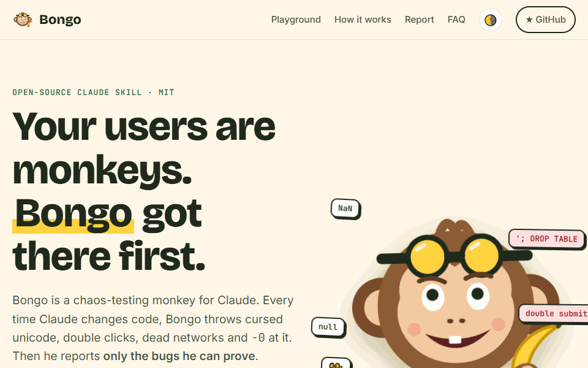

<p align="center">
  
</p>

<h1 align="center">Bongo 🐒</h1>
<p align="center"><b>Your users are monkeys. Bongo got there first.</b></p>
<p align="center">
  An open-source <a href="https://docs.claude.com/en/docs/agents-and-tools/agent-skills">Claude skill</a> that monkey-tests every change Claude makes,<br>
  and reports only the bugs it can prove.
</p>
<p align="center">
  <a href="https://bongo-monkey.vercel.app"><b>Website & live playground</b></a> ·
  <a href="#install">Install</a> ·
  <a href="#how-it-works">How it works</a> ·
  <a href="#the-bongo-report">Bongo Report</a>
</p>
<p align="center">
  <a href="https://bongo-monkey.vercel.app"></a>
  
  
  <a href="https://github.com/Devenio/bongo/stargazers"></a>
</p>

<p align="center">
  <a href="https://bongo-monkey.vercel.app/?victim=slugify&run#playground">
    
  </a><br>
  <sub>▶ <a href="https://bongo-monkey.vercel.app/?victim=slugify&run#playground">Watch Bongo break a function in your browser</a>: no install, takes 2 seconds.</sub>
</p>

---

Unit tests check what you thought of. **Bongo checks what you didn't.** Every time Claude writes code, Bongo throws cursed unicode, `-0`, double submits, dead networks, giant payloads and random clicks at it. Then he does the part most fuzzers skip: he **reproduces, shrinks and verifies** every failure before calling it a bug.

A real run on this repo's [example project](examples/buggy-utils):

```
## 🐒 Bongo Report: src/ (targeted mode)
> Ooh ooh! I bought five plums at $19.99 and the cart charged me $99.94999999999999. 🍌

Banana score: 31/100 🍌🍌 Shaky
Thrown: ~13,150 chaos cases across 18 properties · seed 42

#### 1. [high] slugify leaves a trailing hyphen, so the documented example fails
- Minimal repro: slugify('Hello World!')   // "hello-world-"
#### 2. [high] parseDuration silently ignores characters it doesn't understand
- Minimal repro: parseDuration('1.5h')     // 18000000 (5 hours!)
#### 3. [high] Cart.total() is off by fractions of a cent
- Minimal repro: c.add('plum', 19.99, 5); c.total()   // 99.94999999999999
...4 more, plus open questions and what survived
```

## Install

In Claude Code:

```
/plugin marketplace add Devenio/bongo
/plugin install bongo@bongo
```

That's it. Bongo now guards every code change. You can also call him directly:

> *"monkey test the checkout flow"* · *"try to break src/parser.ts"* · *"fuzz this endpoint"* · `/bongo:monkey-test`

**Only want the skill?** (claude.ai, the Claude API, or Claude Code without hooks) Zip [`skills/monkey-test`](skills/monkey-test) and upload it under **Settings → Capabilities → Skills**, or copy the folder into `~/.claude/skills/`.

## How it works

```
Claude edits code ──► PostToolUse hook notes the file (tests, docs, config and vendored code are ignored)
        │
Claude tries to finish ──► Stop hook: "🐒 Bongo noticed 2 changed files…" (blocks once)
        │
Quick monkey test (~5 min) ──► recon → properties → seeded chaos → triage → Bongo Report
        │
Bugs in Claude's own new code get fixed and pinned with regression tests. Anything else is reported.
```

The skill follows a strict six-step workflow: **Scope → Recon → Plan → Unleash → Triage → Report.**

| Lane | Bongo throws |
|---|---|
| 🍌 Input chaos | empty, huge, emoji/ZWJ, RTL overrides, null bytes, NaN, `-0`, 2⁵³+1, Feb 30, malformed JSON, injection-shaped strings |
| 🔀 Sequence chaos | wrong call order, double submit, use-after-close, retry storms, model-based random operation sequences |
| ⚡ Concurrency chaos | parallel calls, read-modify-write races, cancellation mid-flight |
| 🌪️ Environment chaos | missing env vars, `ENOSPC`, flaky/slow networks, clock skew, `tr_TR` locale, `+05:45` timezones |
| 🖱️ UI chaos | seeded Playwright random walk: clicks, typing, resizing, back/forward, offline; catches XSS, uncaught errors, white screens |
| 🌐 API chaos | wrong methods, malformed or giant bodies, type confusion, `__proto__` pollution; flags 5xx, hangs and leaked stack traces |

It writes **real tests in your project's own framework**: Hypothesis, fast-check, Go native fuzzing, proptest, jqwik, Kotest, FsCheck, Eris or SwiftCheck. Without one, it falls back to a seeded loop.

### Modes

| `BONGO_MODE` | Behavior |
|---|---|
| `gate` *(default)* | Blocks Claude's stop once per batch of code changes and asks for a quick monkey test |
| `nudge` | Never blocks; adds a one-time reminder after the first code edit |
| `off` | Hooks do nothing; the skill still works on request |

Per project, add a `.bongo.json`:

```json
{ "mode": "gate", "ignore": ["scripts/**", "*.config.js", "legacy/**"] }
```

The gate is loop-safe. It fires once per batch, honors Claude Code's `stop_hook_active`, forgets edits made during Bongo's own run, and stays quiet in plan mode.

## Helper scripts

Zero-dependency Node 18+ scripts ship with the skill. Claude runs them, but you can too:

| Script | What it does |
|---|---|
| `detect_stack.mjs [dir]` | Detects languages, test runners, property/fuzz libraries, web frameworks and changed files; recommends tools |
| `chaos_inputs.mjs --type string --seed 42` | Seeded corpus of hostile values: `string number integer date email url path filename json all` |
| `http_monkey.mjs --base http://localhost:3000 --routes "GET /a,POST /b/:id"` | API chaos with curl repros. Accepts an OpenAPI JSON via `--spec`. **Refuses non-local hosts.** |
| `ui_monkey.mjs --url http://localhost:5173 --seed 7` | Playwright random walk with XSS canary, console/5xx/crash capture and screenshots. Avoids "Delete", "Pay" and "Log out". |

## The Bongo Report

Every run ends with a **banana score** (100 minus points per *verified* finding: critical −30, high −15, medium −7, low −3), minimal repros, a "suspicious, unconfirmed" section, what survived, and the regression tests added.

| Score | Verdict |
|---|---|
| 95–100 | 🍌🍌🍌🍌🍌 Bongo-proof |
| 80–94 | 🍌🍌🍌🍌 Sturdy |
| 60–79 | 🍌🍌🍌 Wobbly |
| 30–59 | 🍌🍌 Shaky |
| 0–29 | 🍌 Banana peel |

Survived Bongo? Add the badge:

```markdown
[](https://bongo-monkey.vercel.app)
```

Prefer no jokes? Say "no persona" or set `BONGO_VOICE=off`.

## Safety

- Chaos runs only against **local, disposable** targets: in-process code, localhost, temp dirs. The scripts refuse remote hosts unless you pass `--allow-remote`.
- The UI monkey skips destructive-looking controls and the HTTP monkey skips `DELETE`, unless you pass `--reckless`.
- Every run is seeded and reproducible. Nothing is reported without a repro.

## Try it

[`examples/buggy-utils`](examples/buggy-utils) is a tiny library with planted bugs. Open Claude Code there and say *"monkey test src/"*. No peeking at the spoilers.

## Repository layout

```
.claude-plugin/        plugin.json + marketplace.json (this repo is both)
skills/monkey-test/    the skill: SKILL.md, references/, scripts/
hooks/                 hooks.json + bongo-hook.mjs (track edits, gate the stop)
tests/                 node --test tests/*.test.mjs
examples/buggy-utils/  a playground full of banana peels
site/                  the website (static, deployed on Vercel)
```

## Contributing

New chaos tricks, framework templates and language support are very welcome. See [CONTRIBUTING.md](CONTRIBUTING.md). Run the tests with `node --test tests/*.test.mjs`.

## License

MIT © Bongo contributors. Bongo is a fictional monkey and accepts payment only in bananas.
